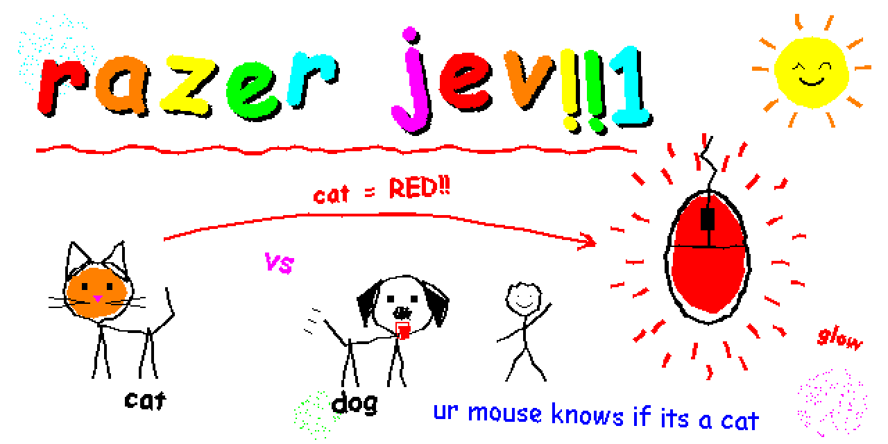
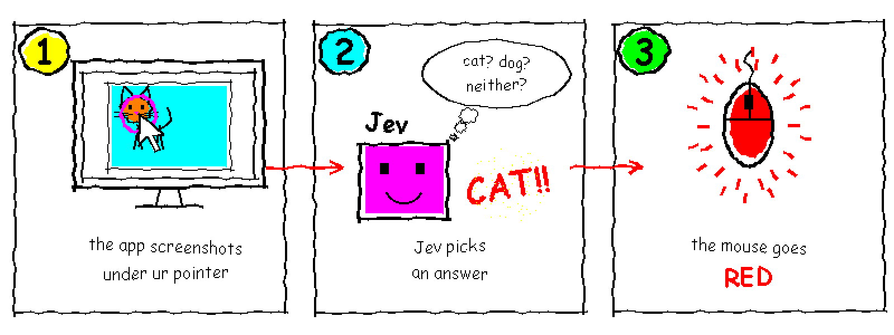
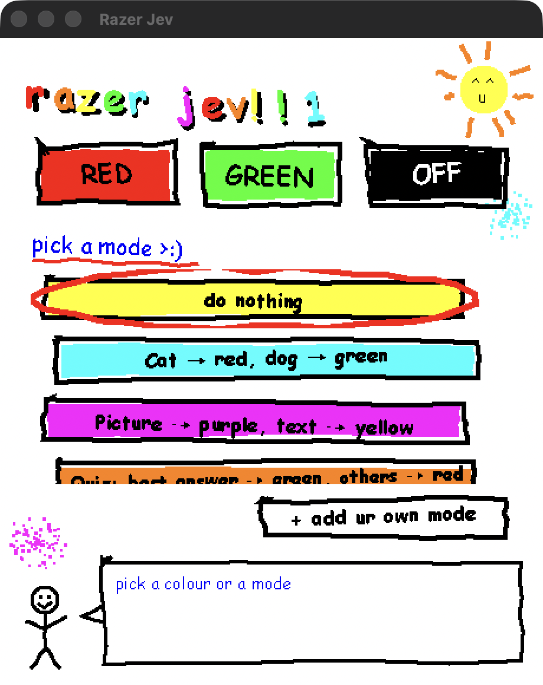
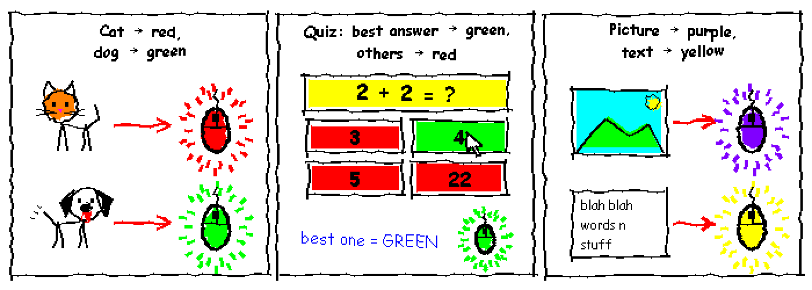
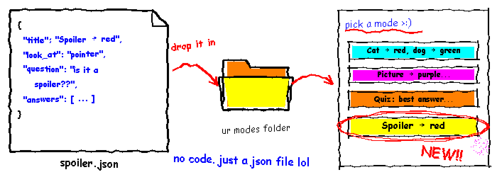

# razer-jev



Colours a Razer Cobra mouse by what the pointer is resting on, judged by [Jev](https://docs.typesafe.ai).

1. The app screenshots what's under your pointer.
2. Jev looks at it and picks an answer (cat, dog or neither; right answer, wrong answer or neither).
3. The app colours the mouse to match.



No Razer software is involved. The app sends the mouse's USB commands directly, as worked out by [OpenRazer](https://github.com/openrazer/openrazer).

## What it looks like





## Build and run

Needs macOS 14 or later and the Xcode command line tools.

```sh
./build.sh                                   # builds ~/Applications/Razer Jev.app
security add-generic-password -s razer-jev -a typesafe-api-key \
  -T ~/Applications/Razer\ Jev.app -w        # paste your TypeSafe API key when asked
open ~/Applications/Razer\ Jev.app
```

The app reads the key from `TYPESAFE_API_KEY` first, then from that Keychain item.

macOS asks for two permissions under System Settings > Privacy & Security: **Input Monitoring** (to talk to the mouse) and **Screen & System Audio Recording** (to see the screen). The first build makes a local signing certificate in `signing/`, so macOS keeps those permissions when you rebuild.

## Add a mode



A mode is one JSON file. No Swift, no rebuild:

1. Click **+ add ur own mode** in the app. It opens your modes folder (`~/Library/Application Support/Razer Jev/modes`) with an example in it.
2. Save a `.json` file there, like this:

```json
{
  "title": "Spoiler → red",
  "look_at": "pointer",
  "question": "`screen` is part of a computer screen. The mouse pointer is at the centre of the magenta ring. Does the text under the pointer give away the ending of a film, show or book?",
  "answers": [
    { "id": "spoiler", "means": "It reveals a plot twist or ending.", "light": "red" },
    { "id": "safe", "means": "It reveals nothing important.", "light": "off" }
  ]
}
```

3. Switch back to the app. The new mode is in the list.

| Field | What it is |
|---|---|
| `title` | The button label |
| `look_at` | `"pointer"` for a 320-point square around the pointer, `"window"` for the whole window under it |
| `question` | What Jev is asked. `` `screen` `` is the screenshot; the pointer is inside a magenta ring |
| `answers` | Two or more. Jev picks one; its `light` is a name (`red`, `green`, `blue`, `yellow`, `orange`, `purple`, `pink`, `cyan`, `white`, `off`) or `#rrggbb` |

The file name is the mode's id on the command line. A file with the same name as a built-in mode replaces it. The built-in modes are in [`modes/`](modes). A broken file shows its problem in the app's speech bubble.

## Layout

| Folder | What it does |
|---|---|
| `modes/` | The built-in modes, copied into the app by `build.sh` |
| `Sources/RazerJev/Watch/` | Loading mode files, and the loop that waits for the pointer to settle, asks Jev and sets the light |
| `Sources/RazerJev/Screen/` | Screenshots around the pointer or of the window under it, with a ring marking the pointer |
| `Sources/RazerJev/Jev/` | The TypeSafe API call and the API key lookup |
| `Sources/RazerJev/Light/` | Colours, the `Light` interface and the Razer Cobra driver. Another device is one more `Light` |
| `Sources/RazerJev/App/` | The window, its MS Paint drawing code (`Paint/`), and the command line |

## Test a mode on a screenshot

```sh
RazerJev --judge quiz screenshot.png 1420 890 --save-marked marked.png
```

`x` and `y` are pixels in the screenshot. `try-it/` has pages to open, hover over or screenshot.

## Command line

```
RazerJev                                     open the window
RazerJev --set red|green|off
RazerJev --judge <mode> <screenshot> <x> <y> [--pixels-per-point 2] [--save-marked out.png]
```

The binary is at `~/Applications/Razer Jev.app/Contents/MacOS/RazerJev`.
